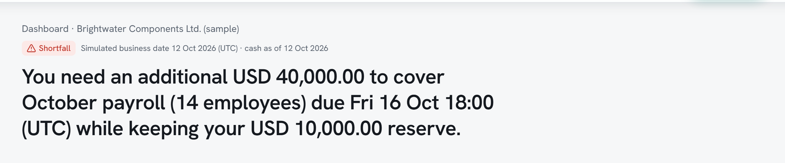
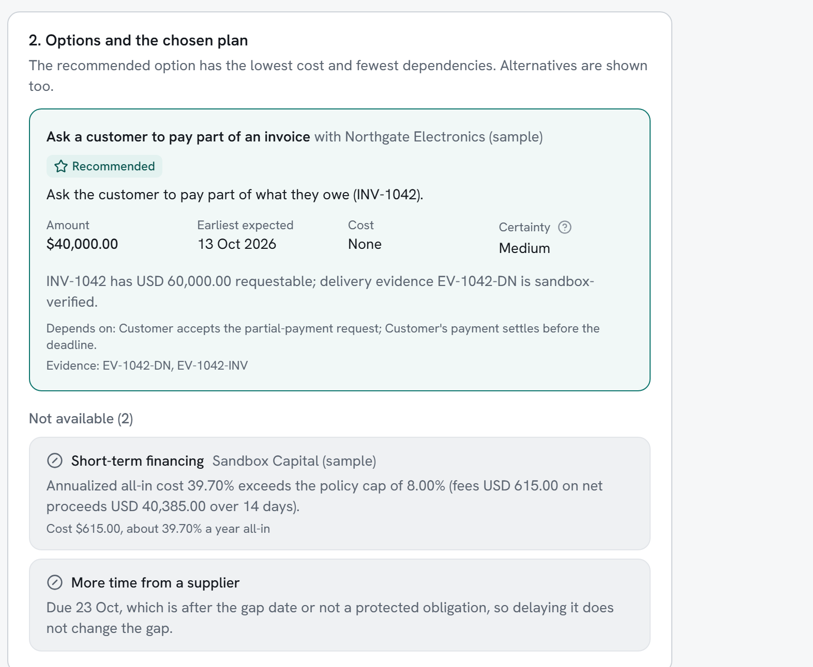
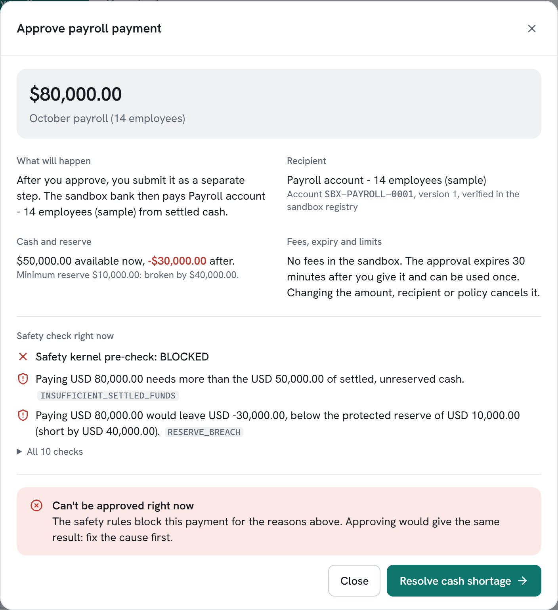
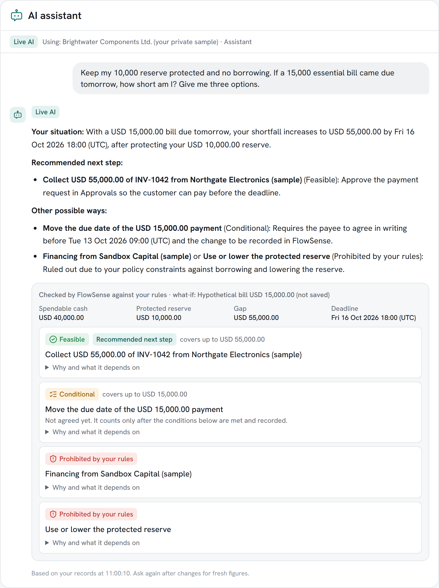
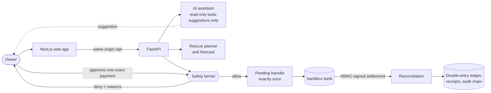

# FlowSense — the AI cash-flow copilot that knows when to say no

[](https://github.com/CodeFahim/FlowSense-/actions/workflows/ci.yml)

**2026 Shenzhen International FinTechathon · International Track · Topic E: SME Finance Copilot · Team Decimal Point (AIUB)**

> *Payroll is Friday. The money isn't there.*
> FlowSense finds the exact cash gap, picks the cheapest fix that keeps the owner's rules, and moves money only after
> the owner approves one exact payment — checked by a safety engine, paid exactly once, and proven with receipts and a
> tamper-evident audit trail.

**Live sandbox:** **https://flowsense-rescue.vercel.app** · create an account with your email (the 6-digit code may land
in spam), then on the welcome screen choose **Try the demo → Open sample** for your own private copy of the sample
business. A backup sign-in is in our submission notes.
The free hosting sleeps when idle: the first visit can take up to a minute ("FlowSense is waking up…").



---

## Why it matters

Small businesses rarely fail on profit; they fail on the week the cash runs out. A customer owes money, payroll is
due first, and under pressure the owner grabs the fastest money: an expensive loan, or the reserve that was meant to
keep the business safe. Small businesses in developing economies face a **US$5.2 trillion** financing gap every year
(IFC, *MSME Finance Gap*, 2017).

Dashboards stop at "you are short". Chatbots suggest things nobody checks. Auto-payments move money on blanket
permission. FlowSense is built to **think like an advisor and act like a careful accountant**.

## The rescue, in one example

| | Amount |
|---|---:|
| Payroll due Friday (14 staff) | 80,000 |
| + Reserve the owner wants to keep | 10,000 |
| − Settled cash in the bank | 50,000 |
| **= Funding gap** | **40,000** |

A customer owes 60,000 (overdue). FlowSense compares the options against the owner's policy:

- **Recommended:** ask the customer to pay 40,000 of what they already owe — no cost.
- **Rejected:** a short-term loan at **39.70% a year**, above the owner's **8%** limit — with the reason shown.
- **No effect:** delaying a supplier whose bill falls after Friday.



## What makes it stand out

<table>
<tr>
<td width="50%" valign="top">

### 1 · FlowSense says no
Try to pay payroll before the money arrives and the safety engine **blocks it** — not enough settled cash, reserve
breached — and offers only *Resolve cash shortage*. There is no "approve anyway", and the **server refuses it too**,
even through the API.

</td>
<td width="50%" valign="top">



</td>
</tr>
<tr>
<td valign="top">

### 2 · AI that keeps your rules
A real answer from the live assistant (Google Gemini). The owner types in plain words — *keep my reserve, no
borrowing, what if a 15,000 bill came due tomorrow?* — and types **no numbers**: the AI already knows the records.
Asked for three options, it says honestly that **only one is safe**.

Under every answer, **FlowSense's own code** labels each option — *Feasible*, *Conditional*, *Prohibited by your
rules* — so the AI can explain the result but **cannot change it**.

</td>
<td valign="top">



</td>
</tr>
</table>

### 3 · Proof, not promises
- A **double-click on "pay" paid exactly once** (idempotent execution, verified on the live site).
- **10/10 scripted scenarios** pass over HTTP ([`scripts/run_scenarios.py`](scripts/run_scenarios.py)): the full
  rescue, partial payment, prompt injection in a document, bank details changed after approval, reserve breach,
  duplicate payroll (concurrent and double-click), bank timeout with an API restart, staff / cross-tenant / missing
  CSRF, a customer refusing, and the full rescue in USD.
- **223 backend tests** on real PostgreSQL and **38 browser journeys** (Playwright) run on **every push** in CI.

## How FlowSense meets the judging criteria

| Criterion | What to look at |
|---|---|
| **Task completion (40%)** — Topic E: financing-option matching, cash-flow management with alerts, business financial analysis | Dated funding gap from settled cash; rescue planner comparing collection, financing (cost vs. policy cap) and supplier extension; 7–60 day forecast and what-if; approvals, simulated settlement, receipts; AI analysis of the business; 12-month sales forecast; document reader that fills forms |
| **Security & compliance (30%)** | Independent safety kernel at propose / approve / execute; approvals bound to amount, recipient version and policy version (single use, 30 min); exactly-once execution; cash changes only on HMAC-signed settlement; append-only ledger, receipts and hash-chained audit enforced by database triggers; tenant isolation (404 for other tenants), CSRF, Argon2id, rate limits |
| **Innovation & interaction (30%)** | An AI copilot that is *allowed to say no*: option classes decided by code, a rule guard on every live answer, confirm-to-act suggestions; documents treated as data, never instructions; 155 currencies; plain-language, mobile-friendly UI |

## How it works



- **The AI can never move money.** It reads records, explains, and can only *suggest* a record or a payment request,
  which the user confirms; payments still need owner approval in Approvals.
- **Settled cash only.** Promises, accepted requests and invoices never reduce the gap until money settles.
- **Every money action** goes through `domain/actions.py` → `safety/kernel.py` at propose, approve and execute.
- **Money is integer minor units** in the business's accounting currency (ISO 4217 decimals, 155 currencies).

## Features

- **Dashboard** — one-sentence situation, settled cash, essential payments, money owed, the shortage.
- **Rescue plan** — options compared against the owner's rules, with evidence and reasons; replans on partial
  payment or a customer's refusal.
- **AI assistant** — on every screen; live Gemini with deterministic "quick answers" as a labelled fallback.
- **Approvals** — exact-amount confirmation, single-use approvals, simulated sending and settlement.
- **Activity & receipts** — full timeline, receipts for every settled payment, one-click integrity check.
- **Money in / out, customers, forecasts** — invoices with evidence, bills and payroll, cash history, sales forecast.
- **Document reader** — PDF, scans and photos (OCR), Word and Excel; values are suggestions the user confirms.
- **Accounts** — sign-up with email codes, private workspaces, owner and staff roles, resettable sample scenarios.

## Tech stack

| Layer | Technology |
|---|---|
| Frontend | Next.js 16, React 19, TypeScript, Tailwind CSS 4, Recharts |
| Backend | Python 3.12, FastAPI, SQLAlchemy 2, Alembic, Pydantic 2 |
| Database | PostgreSQL 16 (immutability and balance enforced by triggers) |
| AI | Google Gemini (live) or Anthropic; offline demo assistant for local runs |
| Documents | Tesseract OCR, Poppler, pypdf — parsed in memory- and time-limited processes |
| Testing & CI | pytest, Playwright, ruff, mypy, eslint, tsc, pip-audit, npm audit — GitHub Actions |
| Hosting | Vercel (web) + Render (API and database) |

## Run it locally

**Prerequisites:** Docker Desktop (or Docker Engine with Compose v2), about 2 GB of free memory, and ports 3000,
8000 and 5432 free. PostgreSQL runs inside Docker; nothing else is required.

**Windows (PowerShell, in the project folder):**

```powershell
Set-ExecutionPolicy -Scope Process Bypass   # allow the project's scripts in this window
.\scripts\setup.ps1                         # creates .env with random local secrets (never overwrites one)
.\scripts\start.ps1                         # builds and starts database, API and web (first run: a few minutes)
.\scripts\demo-credentials.ps1              # prints the demo sign-in details
```

**macOS / Linux:**

```bash
cp .env.example .env
# Edit .env: set POSTGRES_PASSWORD, FLOWSENSE_SANDBOX_EVENT_SECRET (32+ characters),
# FLOWSENSE_DEMO_PASSWORD and FLOWSENSE_FRESH_ACCOUNT_PASSWORD (12+ characters each) to your own random values.
docker compose up -d --build --wait
```

The API runs the database migrations and seeds the synthetic demo data automatically. Then open
**http://localhost:3000** (API health: http://localhost:8000/api/health).

### Five-minute tour

1. Sign in as **demo@flowsense.example** with `FLOWSENSE_DEMO_PASSWORD` from `.env`
   (`fresh@flowsense.example` starts an empty workspace).
2. **Dashboard:** 50,000 in the bank, payroll 80,000 due Friday, reserve 10,000 → **40,000 short**.
3. **Ask AI:** "What are my options to cover payroll?"
4. **Rescue plan:** the recommended collection and the rejected 39.70% loan.
5. **Approvals:** try payroll first — blocked. Approve and send the 40,000 request, then use the sandbox buttons
   **Customer accepts** (cash unchanged) and **Customer pays**. Now approve and submit payroll.
6. **Activity & Receipts:** two receipts and **Check record integrity**.
7. Start again any time: **Demo scenarios → Standard rescue → Reset** (resets archive data; nothing is deleted).

### Configuration

All settings are documented in [`.env.example`](.env.example). Locally, the assistant runs **offline**
(`FLOWSENSE_AI_MODE=demo`); set `FLOWSENSE_AI_MODE=live` with your own Anthropic or Gemini key for the live AI.
Sign-up emails need an email provider (`FLOWSENSE_EMAIL_PROVIDER`). Never commit `.env`.

## Tests

With the stack running (Windows):

```powershell
.\scripts\test.ps1       # backend tests (pytest) inside the API container, separate test database
.\scripts\evidence.ps1   # 10 scripted safety scenarios over HTTP; writes evidence/
.\scripts\e2e.ps1        # browser tests; first run: cd apps\web; npm ci; npx playwright install chromium
.\scripts\verify.ps1     # everything: ruff, mypy, pytest, pip-audit, eslint, tsc, build, npm audit, e2e, evidence
```

macOS/Linux backend tests: `docker compose exec -T api python -m pytest -q`. The same checks run in
[GitHub Actions](.github/workflows/ci.yml) on every push, with throwaway secrets — no repository secrets needed.

## Repository layout

| Path | Contents |
|---|---|
| `services/api/app` | API: `safety/` kernel, `domain/` actions and position, `planning/` planner and forecast, `reconciliation/`, `ledger/`, `audit/`, `agents/` (AI), `documents/`, `fx/` |
| `services/api/alembic` | Database migrations |
| `services/api/tests` | Backend tests |
| `apps/web/src` | Web app (Next.js App Router) |
| `apps/web/e2e` | Browser tests (Playwright) |
| `scripts` | Setup, start, stop, test and verification helpers |
| `samples` | Synthetic documents used by the tests |
| `compose.yaml`, `render.yaml` | Local Docker stack; hosted deployment (Render + Vercel) |

## Honest limitations

- **Sandbox only.** No real bank, money or customer: payments, settlement and customer replies are **simulated**
  through HMAC-signed sandbox events. All data is synthetic.
- **AI** is live on the hosted site; locally it is an **offline demo assistant** unless you add your own key. The AI
  can read, explain and suggest — never approve or move money.
- **Exchange rates** are daily reference rates for display and conversion only; they never change stored records.
- **Document reading** returns suggestions to confirm; long scans are read up to their first 10 pages.
- The free hosting tier sleeps when idle; the planner is designed for small-business volumes and one accounting
  currency per business.

## Roadmap

**Now:** working sandbox → **Next:** a payment provider's test API replaces the simulator → **Then:** a pilot with
one partner bank and a small group of SMEs → **Later:** live bank feeds for alerts before the crunch.

## Team Decimal Point

American International University-Bangladesh (AIUB)

| Name | Contact |
|---|---|
| Tahsin Ahmed Fahim | 23-52735-2@student.aiub.edu |
| Sheikh Akid Bari Rafee | 23-54440-3@student.aiub.edu |
| Faysal Mahmud | 23-54032-3@student.aiub.edu |
| Nahian Islam Rishad | 23-54466-3@student.aiub.edu |

*The sample business, people and documents are fictional.*
